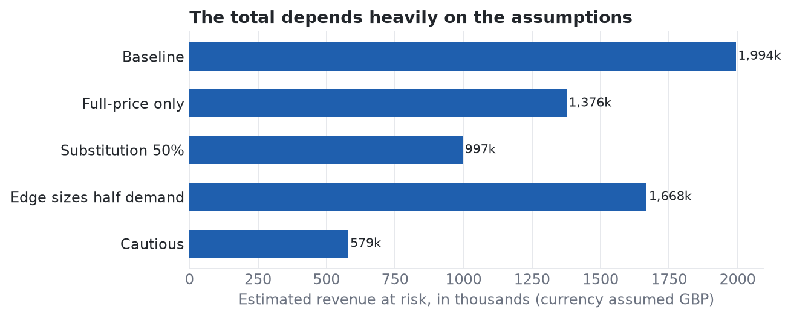
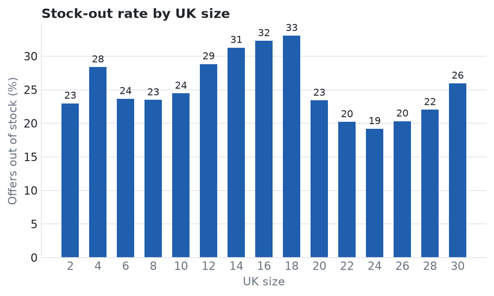

# How much revenue do ASOS stock-outs put at risk?

Product pages show which sizes are sold out, so it is easy to multiply price by missing sizes and call it lost revenue. I wanted to see how much of that number is data and how much is assumption.



## What I found

After cleaning, the data covers 29,843 products with more than one size.

- **28.2% of size offers are out of stock**, and 56.0% of products are missing at least one size.
- **The total is mostly assumption.** It ranges from about 1.99M at one lost sale per missing size to about 0.58M with cautious assumptions, which is 29% of the baseline.
- **The brand order barely changes.** Across 41 brands, the Spearman correlation with the baseline ranking stays at 0.975 or higher, and at least 9 of the top 10 stay the same. So the data can tell you which brands to look at, but not how much money is at stake.
- **Exposure follows catalogue size.** ASOS DESIGN has the largest total with a stock-out rate close to average (29.3%), while Pull&Bear (43.7%) and Reclaimed Vintage (42.3%) have the highest rates.
- **Size matters.** The last size in a range is out of stock 35.7% of the time, against 27.6% in the middle and 24.4% for the smallest. UK 14 to 18 run at 31 to 33%, UK 6 to 8 at about 24%.
- **Category matters.** Knitwear is at 42.8% and coats and jackets at 36.5%, dresses at 22.5%. The file has no date, so this may be seasonal.



## Cleaning problems worth knowing about

- 856 repeat rows, resolved by using the SKU as the key.
- 483 rows where the URL points to a different product than the name. The product code in the description always matches the SKU, so I treat the URL as the broken field.
- Mixed prices such as `Now 14.50` and `From 42.50`.
- No brand or category column, so I derive them from the product name.

## What this can't tell you

It is one scrape with no sales, stock levels or date. A size can be out of stock because it sold well or because little was bought. The scenario multipliers are my assumptions. Not one product has every size sold out, so products that sold out completely are probably missing. I assume prices are in GBP because the sizes are UK sizes.

## Run it

```bash
pip install -r requirements.txt
./get_data.sh
jupyter notebook notebooks/analysis.ipynb
```

The idea and the dataset come from [this tutorial by Lore So What](https://www.youtube.com/watch?v=ux9uxKM171E). The file is not stored here because its licence is unclear; the script downloads it from the author's shared folder. The cleaning, size analysis and scenarios are mine.
